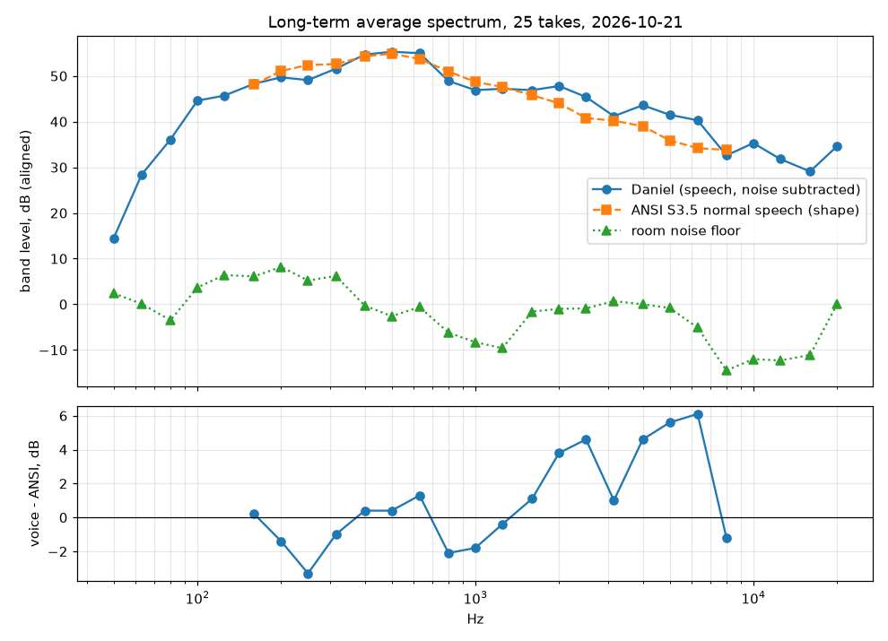

# Voice profile AFTER the podcast chain (2026-10-21)

Same analysis run on `data/processed/podcast` (config/podcast-chain.json). Generated by `scripts/voice_profile.py` from 25 takes (59.3 s of speech, 16.0 s of room noise), filter `floor_dbfs <= -57.0`. Method: `docs/voice-profile.md`. Machine-readable copy: `profile.json`.

| | |
|---|---|
| Pitch (F0) | median 105.8 Hz, 5th-95th percentile 78.5-196.9 Hz (15.9 semitones) |
| Formants (median) | F1 469.9, F2 1586.8, F3 2368.4 Hz |
| Spectral centroid | 767 Hz |
| Spectral tilt 250 Hz-8 kHz | -7.1 dB/octave |
| Sibilance | peak at 4090 Hz; 5-9 kHz is -10.6 dB vs 1-4 kHz |
| Loudness per take | median -20.0 LUFS (-22.0 to -20.0) |
| Mains hum in the noise floor | 50 Hz +2.7 dB, 100 Hz +0.8 dB, 150 Hz -0.5 dB over neighbouring bins |

## One-third-octave spectrum

Voice level-aligned to ANSI S3.5-1997 normal-effort speech over 160 Hz-8 kHz; `dev` = voice minus reference.

| Band (Hz) | Voice dB | ANSI dB | dev | Noise dB | SNR |
|---:|---:|---:|---:|---:|---:|
| 50 | 14.5 |  |  | 2.4 | 12.2 |
| 63 | 28.4 |  |  | 0.1 | 28.4 |
| 80 | 36.1 |  |  | -3.5 | 39.6 |
| 100 | 44.6 |  |  | 3.7 | 40.8 |
| 125 | 45.7 |  |  | 6.4 | 39.3 |
| 160 | 48.3 | 48.1 | 0.2 | 6.1 | 42.1 |
| 200 | 49.7 | 51.1 | -1.4 | 8.2 | 41.6 |
| 250 | 49.1 | 52.4 | -3.3 | 5.2 | 43.9 |
| 315 | 51.6 | 52.6 | -1.0 | 6.2 | 45.3 |
| 400 | 54.7 | 54.3 | 0.4 | -0.3 | 55.0 |
| 500 | 55.3 | 54.9 | 0.4 | -2.6 | 57.9 |
| 630 | 55.0 | 53.7 | 1.3 | -0.6 | 55.6 |
| 800 | 48.9 | 51.0 | -2.1 | -6.2 | 55.1 |
| 1000 | 46.9 | 48.7 | -1.8 | -8.3 | 55.2 |
| 1250 | 47.2 | 47.6 | -0.4 | -9.6 | 56.8 |
| 1600 | 46.9 | 45.8 | 1.1 | -1.6 | 48.4 |
| 2000 | 47.8 | 44.0 | 3.8 | -1.0 | 48.8 |
| 2500 | 45.4 | 40.8 | 4.6 | -0.9 | 46.3 |
| 3150 | 41.2 | 40.2 | 1.0 | 0.7 | 40.5 |
| 4000 | 43.6 | 39.0 | 4.6 | -0.0 | 43.6 |
| 5000 | 41.5 | 35.9 | 5.6 | -0.8 | 42.3 |
| 6300 | 40.3 | 34.2 | 6.1 | -5.1 | 45.4 |
| 8000 | 32.6 | 33.8 | -1.2 | -14.5 | 47.1 |
| 10000 | 35.3 |  |  | -12.0 | 47.3 |
| 12500 | 31.8 |  |  | -12.3 | 44.2 |
| 16000 | 29.1 |  |  | -11.1 | 40.2 |
| 20000 | 34.6 |  |  | -0.0 | 34.7 |

