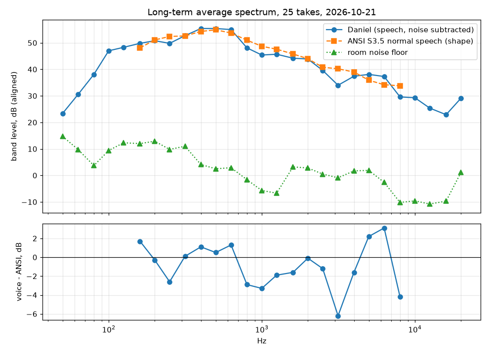

# Voice profile (2026-10-21)

Generated by `scripts/voice_profile.py` from 25 takes (57.5 s of speech, 18.7 s of room noise), filter `floor_dbfs <= -57.0`. Method: `docs/voice-profile.md`. Machine-readable copy: `profile.json`.

| | |
|---|---|
| Pitch (F0) | median 105.1 Hz, 5th-95th percentile 78.1-185.0 Hz (14.9 semitones) |
| Formants (median) | F1 437.5, F2 1557.1, F3 2335.5 Hz |
| Spectral centroid | 541 Hz |
| Spectral tilt 250 Hz-8 kHz | -7.8 dB/octave |
| Sibilance | peak at 5273 Hz; 5-9 kHz is -10.6 dB vs 1-4 kHz |
| Loudness per take | median -22.1 LUFS (-25.5 to -20.0) |
| Mains hum in the noise floor | 50 Hz +7.4 dB, 100 Hz +0.0 dB, 150 Hz -0.3 dB over neighbouring bins |

## One-third-octave spectrum

Voice level-aligned to ANSI S3.5-1997 normal-effort speech over 160 Hz-8 kHz; `dev` = voice minus reference.

| Band (Hz) | Voice dB | ANSI dB | dev | Noise dB | SNR |
|---:|---:|---:|---:|---:|---:|
| 50 | 23.4 |  |  | 14.7 | 8.7 |
| 63 | 30.5 |  |  | 9.8 | 20.7 |
| 80 | 38.1 |  |  | 3.7 | 34.4 |
| 100 | 47.0 |  |  | 9.4 | 37.6 |
| 125 | 48.3 |  |  | 12.3 | 36.0 |
| 160 | 49.8 | 48.1 | 1.7 | 12.0 | 37.7 |
| 200 | 50.8 | 51.1 | -0.3 | 12.9 | 37.8 |
| 250 | 49.8 | 52.4 | -2.6 | 9.8 | 40.0 |
| 315 | 52.7 | 52.6 | 0.1 | 11.0 | 41.6 |
| 400 | 55.4 | 54.3 | 1.1 | 4.1 | 51.3 |
| 500 | 55.4 | 54.9 | 0.5 | 2.5 | 52.9 |
| 630 | 55.0 | 53.7 | 1.3 | 2.9 | 52.1 |
| 800 | 48.1 | 51.0 | -2.9 | -1.6 | 49.7 |
| 1000 | 45.4 | 48.7 | -3.3 | -5.7 | 51.1 |
| 1250 | 45.7 | 47.6 | -1.9 | -6.7 | 52.4 |
| 1600 | 44.2 | 45.8 | -1.6 | 3.2 | 41.0 |
| 2000 | 43.9 | 44.0 | -0.1 | 2.8 | 41.1 |
| 2500 | 39.6 | 40.8 | -1.2 | 0.5 | 39.2 |
| 3150 | 34.0 | 40.2 | -6.2 | -0.9 | 34.8 |
| 4000 | 37.4 | 39.0 | -1.6 | 1.7 | 35.8 |
| 5000 | 38.1 | 35.9 | 2.2 | 1.9 | 36.2 |
| 6300 | 37.3 | 34.2 | 3.1 | -2.6 | 39.9 |
| 8000 | 29.6 | 33.8 | -4.2 | -10.2 | 39.8 |
| 10000 | 29.3 |  |  | -9.6 | 38.9 |
| 12500 | 25.4 |  |  | -10.8 | 36.2 |
| 16000 | 22.9 |  |  | -9.7 | 32.7 |
| 20000 | 29.1 |  |  | 1.1 | 28.0 |

## Suggested EQ (heuristic; confirm by A/B)

| Type | Freq | Gain | Q | Why |
|---|---:|---:|---:|---|
| highpass | 60 Hz |  |  (order 4) | below the lowest voiced pitch (0.8 x F0 5th percentile): rumble, AC, handling |
| peak | 1000 Hz | 1.4 | 1.4 | voice is -2.9 dB vs ANSI S3.5 average speech here (smoothed) |
| peak | 3150 Hz | 1.9 | 1.4 | voice is -3.8 dB vs ANSI S3.5 average speech here (smoothed) |
| highshelf | 10000 Hz | 1.5 | 0.707 | optional 'air' for podcast playback; SNR above 10 kHz is 36 dB, so it lifts little noise |

